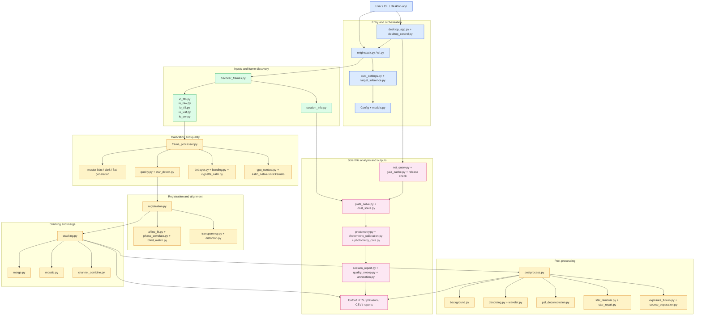

# OriginStack Architecture Diagram

This project is organized as a streaming astrophotography processing pipeline: raw frames are discovered, calibrated, aligned, stacked, and optionally post-processed without holding the full dataset in memory.

## Layered view

The project is built around a four-phase pipeline:

1. Input discovery and calibration
   - File format readers load FITS, RAW, TIFF, XISF, SER, and other camera frames.
   - Phase 1 normalizes channel-first RGB FITS cubes `(3, H, W)` to its internal channel-last `(H, W, 3)` layout.
   - `frame_discovery.py` classifies lights, darks, flats, and calibrations.
   - `frame_processor.py` runs the per-frame processing queue and quality scoring.

2. Registration
   - `registration.py` aligns frames onto a common coordinate system using star matching, phase correlation, and optional distortion models.
   - `affine_fit.py`, `phase_correlate.py`, and `blind_match.py` handle rigid transforms and unknown-rotation recovery.

3. Stacking and merging
   - `stacking.py` combines aligned frames into the linear master stack.
   - `merge.py` merges prior stacks into a larger hierarchical or multi-session result.
   - `mosaic.py` and `channel_combine.py` extend the stack into combined outputs and colour workflows.

4. Post-processing and analysis
   - `postprocess.py` orchestrates background extraction, denoising, star repair, deconvolution, and local contrast.
   - `photometry.py`, `plate_solve.py`, and `session_report.py` produce scientific and reporting outputs.
   - `net_query.py` and `gaia_cache.py` supply external catalog and WCS information when available.

## Key architectural principles

- Streaming memory model: frames are processed and released incrementally instead of loading the full dataset into memory.
- Modular pipeline: each phase is implemented in a dedicated module family with a clear responsibility boundary.
- Native acceleration: the hot paths can use `ext/astro_native` Rust kernels while falling back to NumPy/SciPy implementations.
- Desktop + CLI integration: the same pipeline is exposed via the terminal and the native desktop GUI.
- Desktop release checks run in the background and deliver any update notice through the Tkinter main-thread poll.
- Scientific extension: the stack is not just an image combine; it also supports plate solving, photometry, noise validation, and reporting.
